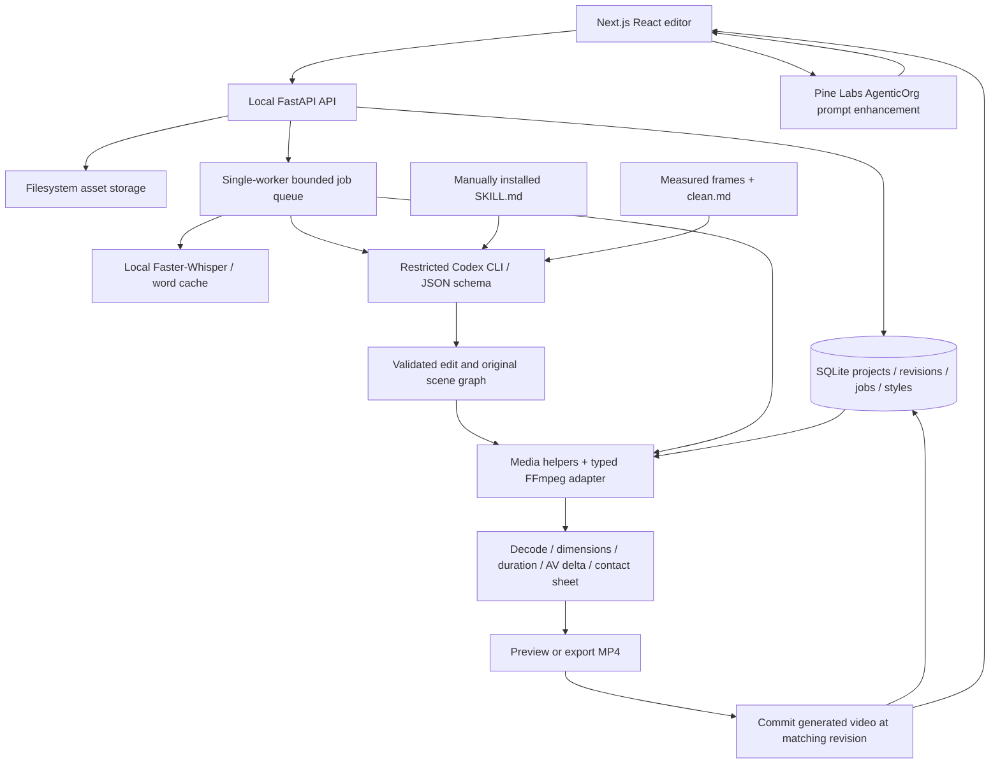

# Architecture

ImaginePro combines a visual editor, project storage, an AI director, and a media rendering pipeline.



## Source of truth

`projects.timeline` is the authoritative structured timeline. A revision is incremented by every accepted manual save or plan approval. Source IDs resolve through project-scoped asset records, never AI-provided host paths. Each rendering job captures an immutable timeline/revision snapshot; result metadata identifies that revision. The frontend displays the current render only when the revision matches. New edits invalidate its current-preview status, while old artifacts remain accessible in Activity.

The default `generate` job takes one prompt/style/media snapshot, plans source edits when footage exists, composes original illustrations, renders and verifies an MP4, then commits that real generated asset as an editable clip automatically. Optimistic concurrency against `base_revision` prevents a late job from overwriting newer edits. Failures/cancellation before commit preserve the saved timeline. The older explicit `plan`/approval endpoints remain compatible, with their own revision check.

## Modules

- `backend/main.py`: API, loopback/Origin/header checks, media delivery including range requests, static frontend serving.
- `db.py`: SQLite records, explicit project scoping, revision saves and job state.
- `models.py`: finite/bounded clip times, asset identifiers, supported-effect enums and strict planner schemas.
- `jobs.py`: bounded single-worker queue, isolated job directories, progress, result persistence, cancellation signals and recoverable failures.
- `agent.py`: provider boundary and working Codex implementation. No execution of free-form output. General API-provider fields do not change the active video-generation runtime.
- `generation.py`, `composition.py`: direct generation orchestration and bounded 2D scene schemas. Original paths, character groups, typography and poses are data interpreted by trusted Canvas code. Footage intermediates and graphics use lossless encoding before the delivery encode.
- `transcripts.py`: TXT/SRT/VTT ingestion and Windows System.Speech narration. Recorded audio is supported independently of Windows speech synthesis.
- `director.py`: separate Pine Labs AgenticOrg enhancement endpoint. It sends only the video prompt, selected style and broad input format to a dedicated tool-free director agent. Company membership and agent tools/status are checked before chat execution; authentication/approval/rate errors are returned visibly. No fallback silently substitutes Codex.
- `local_secrets.py`: Windows DPAPI-encrypted AgenticOrg credential storage under ignored storage/secrets. Server environment variables are supported. No credential is returned to the browser, included in prompts or written into configuration JSON.
- `transcription.py`: CPU int8 Faster-Whisper model cache, content-hash transcript cache, Scribe-compatible word mapping, explicit unsupported diarization.
- `rendering.py`: normalize every segment to one canvas/FPS/audio layout, 30ms edge fades, copy-concat, optional title and output fade, mixed PCM audio and measured loudness, ASS captions last, H.264/AAC MP4, verification.
- `styles.py`: read-only manual-skill discovery; reference profile inspection/editing. Supporting resource inventories are provided as context, with no arbitrary script dispatch.
- `reference.py`: direct media download with public-IP pinning and bounded redirects, FFmpeg scene-change sampling, palettes/statistics, bounded contact-sheet analysis and structured clean.md generation.

## Storage and isolation

```text
storage/
  editor.sqlite3
  cache/models/                    public local ASR weights
  cache/transcripts/<sha>_<model>.json
  projects/<project_id>/
    sources/<asset_id>.<extension>  immutable imported footage
    downloads/<asset_id>.media      validated direct-URL imports
    edit/jobs/<job_id>/
      agent/schema.json, decision.json, request.json
      timeline.json, edl.json
      seg_*.mp4, base.mp4, audio.wav
      title.png, captions.ass
      output.mp4, verification.json, verification.jpg
  styles/reference_<id>/
    clean.md, metadata.json, contact_sheet.jpg
    sampled_frames/
```

Only generated intermediates are written in job directories; the app does not edit originals. The original skill's session-output convention is preserved beneath each project's media workspace in edit/. Runtime data and footage are Git-ignored.

## Execution boundaries

The server binds loopback and rejects untrusted Hosts, browser Origins and write requests lacking the custom editor header. These prevent common cross-site request/DNS-rebinding paths to a local service; they do not provide public authentication. The local owner and other trusted processes on the same machine are the trust boundary.

Codex runs ephemeral and read-only, ignoring user configuration/rules, with shell, browser, computer, app/plugin integrations, hooks and subagents disabled. It receives explicit data through stdin. Credentials are used only by the supported CLI account flow; API-key environment variables are excluded from the child environment. Per-job outputs use backend-owned paths. Unexpected command/MCP/web execution events cause rejection. These installed-version feature flags are defense in depth; a public deployment still requires a separate OS/container boundary and a reviewed provider arrangement.

FFmpeg uses argument arrays and no shell interpolation. The model chooses typed preset/operation fields, never command strings. Project scope, clip duration, total duration, media type, source bounds, filename, image dimensions and queue size are checked. URL imports validate all resolved addresses, pin the connection to a validated public IP, retain HTTPS certificate verification/SNI and revalidate redirects. No credentials, login scraping, YouTube session adapters or DRM bypass are implemented.

## Reliability and verification

One worker limits CPU/memory contention. Every job has queued/running/completed/failed/cancelled state, progress and persisted errors. FFmpeg and CLI processes are cancellable and timeout-bounded. Native ASR model loading/inference can only notice cancellation at its next cooperative boundary. Restarting marks incomplete jobs failed; source assets and saved timelines are recoverable.

Every delivered render must exist, probe as H.264 at its requested canvas, match timeline duration within 350ms, fully decode and have audio/video stream durations within 250ms. Contact sheets sample the beginning, middle, ending and both sides of every cut. Caption generation fails if requested with no detected speech. These are media-integrity checks; human review still determines visual quality, transcription accuracy and narrative correctness.

The graphical timeline itself only displays video and its source audio; it never encodes source pixels. Generated videos become ordinary editable media clips. Caption/title effects on manual timelines remain structured render settings rather than separate tracks. Generation uses lossless source/illustration intermediates and one H.264 CRF20 delivery encode; audio uses a final one-pass loudness filter. The existing manual final export uses measured two-pass normalization when possible. Displaying the finished clip does not encode it again.
